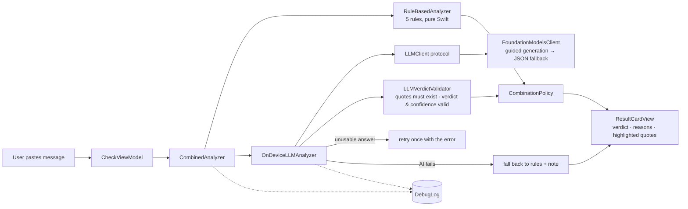

# ScamCheck

**Paste a suspicious text, UPI request, delivery notice or job offer. Get a clear verdict, the reasons, and the exact words that triggered each reason, all checked on your iPhone.**

<!-- Add 2–3 screenshots here: input screen, a "Likely scam" card, a "Looks fine" card.
        -->

SwiftUI · iOS 27 · MVVM · Apple Foundation Models (on-device LLM) · Swift Testing · no third-party dependencies

---

## The problem

People in India get a steady stream of messages about bank KYC, UPI refunds, parcels on hold, part-time jobs and prizes. Many are scams, and many genuine messages look almost the same ("Do not share this OTP", "Not you? Call immediately"). A bare "risk score" doesn't help someone decide what to do. They need to see **why**.

ScamCheck gives one of three verdicts (**Likely scam**, **Suspicious** or **Looks fine**) with a short list of reasons, and highlights the exact phrases in the message that caused each one. It never blocks, deletes or reports anything. **The user decides.**

Design rule: **precision over recall.** Calling a real bank alert a scam is worse than missing one scam, so the app is measured with **F0.5**.

## How it works



**1. Rules (pure Swift, fully unit-tested).** Five rules, each in its own file:

| Rule | Example it catches | Strength |
|---|---|---|
| Credential request | "share the OTP", "send your UPI PIN" (but not "do **not** share", including the curly ’) | strong |
| Payment trick | "enter your UPI PIN to **receive**", "scan the QR to receive" | strong |
| Fee for prize / job | needs *both* a prize/job word *and* a fee | strong |
| Links | lookalikes (`sbi-kyc-update.com`, `amaz0n-…`), raw IPs, brand ≠ link domain (strong); shorteners (weak). `.bank.in` links (RBI-only domains since Oct 2025) are trusted. | strong / weak |
| Urgency / threats | "within 24 hours", "will be blocked" (not "immediately", which genuine debit alerts use) | weak |

Verdict from rules: two different strong signs, or strong + weak, gives **Likely scam**. One strong sign, or two weak kinds, gives **Suspicious**. One weak sign alone stays **Looks fine** and is shown as "worth noticing".

**2. On-device LLM (Apple Foundation Models).** The model fills in a Swift type (`@Generable`) with reasons first, then the verdict and confidence. That type is also `Codable`, so JSON text decodes into it too. If Apple's default safety filter blocks the request, the client retries in Apple's permissive mode, asking for JSON text instead. The message never leaves the phone.

**3. Every AI answer is validated before it's shown.**
- The verdict must be allowed and confidence must be 0–1. Otherwise the answer is unusable: the app **retries once**, telling the model exactly what was wrong.
- Every quote must really appear in the message **and** be specific evidence: a short phrase (≤ 12 words, not a whole sentence). "Do **not** share your OTP" can't count as a request to share it, and a link to an official site (amazon.in, `*.bank.in`) can't count as a suspicious link. Failing quotes are dropped, and the card says how many.
- An AI flag with no surviving evidence is treated as "Looks fine", with a note.

**4. Combining, conservatively** (`CombinationPolicy`, version 2):
- **Likely scam** only if both say so, or the rules found 2+ kinds of strong sign.
- **Suspicious** if the rules flagged it but that bar isn't met.
- **Looks fine** if the rules found nothing, **whatever the AI says**. Anything the AI noticed is still listed as "worth noticing", so the user can judge.
- The AI is a second opinion that can *confirm* and *explain* a scam, but it can't raise a warning on its own. Version 1 let it, and the first evaluation showed why that was a mistake (see below).
- If the AI fails, the user still gets the rules' answer, with a note.

**5. Debug log.** Failures, retries, dropped quotes, fallbacks and disagreements go to a private on-device log, which exports as Markdown for [`WRONG_ANSWERS.md`](WRONG_ANSWERS.md).

## Evaluation

40 **synthetic** labelled messages (20 scams across UPI, bank, delivery, job, OTP and prize, plus 20 genuine ones, including tricky messages that look scammy but are real). This set is kept separate from the messages used to design the rules. Details and history: [`EVALUATION.md`](EVALUATION.md).

| Analyzer | Precision | Recall | **F0.5** | False alarms (of 20 genuine) | Missed scams (of 20) |
|---|---|---|---|---|---|
| AI only, before | 0.51 | 0.90 | 0.56 | 17 | 2 (+3 errors) |
| Combined, policy v1 (before) | 0.53 | 1.00 | 0.58 | 18 | 0 |
| AI only, after stricter evidence checks | 0.68 | 0.95 | 0.72 | 9 | 1 |
| **Combined, policy v2 (after)** | **0.94** | **0.80** | **0.91** | **1** | **4** |

*Measured on iPhone 17 Pro, iOS 27.2.1, 26 Nov 2026. "Flagged" = Suspicious or Likely scam. The "after" changes were made after seeing the "before" run (disclosed in [`EVALUATION.md`](EVALUATION.md)).*

**What the numbers say:**
- Making the AI a *second opinion* instead of a co-decider cut false alarms from **18 to 1** (precision 0.53 → 0.94). The cost: recall went from 1.00 to 0.80.
- Stricter checks on the AI's own evidence raised its standalone precision from 0.51 to 0.68. That's still too many false alarms for it to raise warnings on its own.
- Remaining errors:
  - **False alarm:** a genuine delivery message asking you to share the delivery OTP *with the agent*.
  - **Missed scams:** a "sent money by mistake, please return it" UPI trick, a customs-duty payment via a short link, a fake support agent asking you to "share it" (the OTP), and a prize link on an unknown domain.
  - In all four missed scams the AI noticed something; it's shown to the user as "worth noticing", but not counted as a warning.

## What the model (and I) got wrong

Full log, including how each problem was caught: [`WRONG_ANSWERS.md`](WRONG_ANSWERS.md). Highlights:

- **The on-device AI over-flags genuine messages.** On the first evaluation it flagged **17 of 20** genuine messages (precision 0.51), including a "do not share" OTP alert, a salary credit, an Amazon tracking link and a real job offer. Its "evidence" was often a whole innocent sentence, such as "It is valid for 5 minutes." labelled as urgency.
- **My first combining rule passed those false alarms through.** It showed "Suspicious" whenever rules and AI disagreed, and "Suspicious" counts as a warning. So Combined scored **precision 0.53 / F0.5 0.58**, worse than the rules alone. The fix was policy v2 (the AI can't raise a warning alone) plus stricter evidence checks on AI quotes. These changes were made *after* seeing that run, which is disclosed in `EVALUATION.md`.
- **Apple's safety filter blocks some scam messages on the real iPhone** (not just in the Simulator). The permissive JSON fallback answered those, and when its JSON was also unusable, the retry or the rules covered it.

- **A misleading safety-filter error from the Simulator.** In the Simulator, every AI request failed with "Safety guardrails were triggered", even a harmless OTP message. I first blamed Apple's filter. The full error showed the safety model couldn't even load, because the Simulator (iOS 27.2) uses the Mac's Apple Intelligence (macOS 26.6). On the real iPhone the same messages worked. **Lesson: check *where* a test ran before deciding what its result means.** The real-model tests now skip themselves in the Simulator.
- **A test that hid a broken feature.** The first AI smoke test treated a safety block as acceptable, so it stayed green while the AI wasn't working at all. It now fails on any error.
- **Rules that would have flagged genuine messages**, caught by must-not-trigger tests before shipping: curly apostrophes in "don’t share", a friend asking "send me the wifi password", and "call immediately" in real debit alerts.
- **Known false alarm:** a genuine delivery message asking you to share the delivery OTP *with the agent* is flagged as Suspicious by the rules.

<!-- Add 1–2 interesting misclassifications from the evaluation run here. -->

## Limitations

- **Synthetic data only.** 40 evaluation messages is small. The scores show direction, not production accuracy.
- **English only**, with India-specific brands and patterns.
- **Can't see the sender.** A pasted message doesn't say who sent it or whether they're in your contacts.
- **The brand → official-domain list is hand-made** (`KnownBrands.swift`) and must be maintained. A missing genuine domain causes a false alarm.
- **Only on supported devices.** The AI needs an Apple Intelligence device (iPhone 15 Pro or later). Elsewhere, the app uses rules only.
- **Model updates change behaviour.** Apple updates the on-device model with iOS, so the evaluation should be re-run after each iOS update.
- **No Share Extension or Shortcut yet** (see below).

## What I'd do next

1. **A Shortcuts action / App Intent**, so a message can be sent to ScamCheck from Messages without copy and paste. Deferred because it adds a second entry point that needs its own testing, and extensions have tighter memory limits that the on-device model may not fit.
2. **A larger, reviewed dataset**, including Hindi and Hinglish messages, and per-category scores.
3. **Fix the delivery-OTP false alarm** by adding a *new* test message first, rather than tuning against the evaluation set.
4. **Apple's Evaluations framework**, to track scores across iOS and model updates.
5. **A user "this was wrong" button** that writes to the local log, with no data leaving the phone.

## Project structure

```
ScamCheck/
  Models/AnalysisResult.swift        Verdict, Reason (with exact quote + position), AnalysisResult
  Analysis/
    MessageAnalyzer.swift            the protocol every analyzer follows
    RuleBasedAnalyzer.swift          runs the rules → VerdictPolicy
    Rules/                           one file per rule + link parsing + known brands
    LLM/                             LLMVerdict (@Generable + Codable), validator, client, analyzer
    CombinationPolicy.swift          the rules + AI decision table
    CombinedAnalyzer.swift           runs both, falls back to rules
  ViewModels/CheckViewModel.swift
  Views/ResultCardView.swift, ContentView.swift
  Debug/                             on-device failure log + viewer (Debug builds)
ScamCheckTests/                      100+ checks: every rule (incl. must-NOT-trigger), validator, retry/fallback, evaluation
CLAUDE.md · DECISIONS.md · WRONG_ANSWERS.md · EVALUATION.md
```

## Running it

1. Xcode 27.2+, iOS 27.2 deployment target. Open `ScamCheck.xcodeproj`.
2. **⌘R** runs the app. AI features need a real Apple Intelligence iPhone; in the Simulator, use "Rules".
3. **⌘U** runs the tests. Evaluation: see [`EVALUATION.md`](EVALUATION.md).

## Privacy

All checks run on the device. No server, no analytics, no API keys. Release builds store no message text. The debug log (Debug builds only) keeps an 80-character preview so failures can be studied.

---

*Built as a portfolio project with an AI coding assistant. Decisions, mistakes and their fixes are recorded in `DECISIONS.md` and `WRONG_ANSWERS.md`.*
